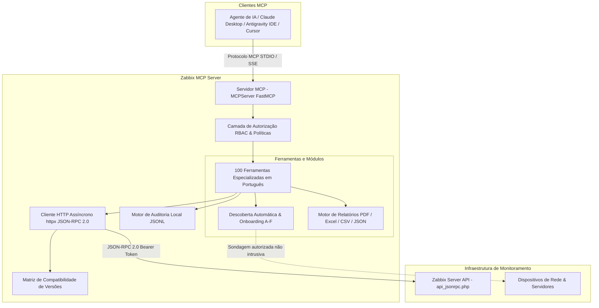

# Arquitetura do Zabbix MCP Server

O **Zabbix MCP Server** é estruturado sobre padrões corporativos de observabilidade, segurança e integração assíncrona.

## Componentes Principais

1. **`MCPServer` (FastMCP):** Instância central que expõe as 100 ferramentas, recursos e prompts para agentes de IA através do Model Context Protocol oficial.
2. **Camada de Autorização e Políticas:**
   - Modo `somente_leitura`: Permite apenas consultas (`host.get`, `item.get`, relatórios).
   - Modo `operacional`: Permite cadastros, atualizações de itens e janelas de manutenção.
   - Modo `administrativo`: Permite exclusão de hosts, proxies e gerenciamento avançado.
   - **Tokens de Aprovação em 2 Passos:** Impede execução acidental de ações destrutivas.
3. **Cliente JSON-RPC 2.0 Assíncrono (`ZabbixClient`):**
   - Comunicação via `httpx.AsyncClient` com semáforo de concorrência e retries com backoff exponencial.
   - Autenticação adaptativa (cabeçalho `Authorization: Bearer <token>` para Zabbix 7.0+ e body auth para <= 6.4).
4. **Módulo de Descoberta e Onboarding:**
   - Estágios A a F: Descoberta controlada, fingerprinting, deduplicação com o inventário existente, prévia detalhada, cadastro em lote e verificação de coleta.
5. **Motor de Relatórios Profissionais:**
   - Geração local de PDF (ReportLab com layout corporativo), Excel (openpyxl com múltiplas abas), CSV, JSON e Markdown.
