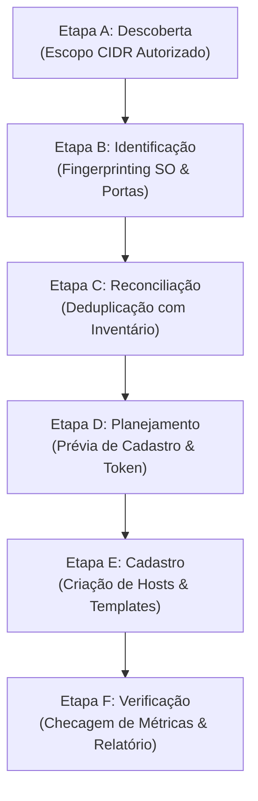

# Guia de Descoberta Automática e Onboarding de Dispositivos

O diferencial central do **Zabbix MCP Server** é o fluxo de onboarding estruturado em 6 etapas rigorosas (Estágios A ao F).

## Etapa A — Descoberta de Rede
- A ferramenta `zabbix_descobrir_rede` recebe o bloco CIDR (ex: `192.168.0.0/24`) e exige confirmação formal (`confirmar_escopo_autorizado=True`).
- Aplica semáforo de taxa de conexões (máximo 20 conexões simultâneas) para não sobrecarregar equipamentos de rede.
- Proíbe varredura em faixas loopback (`127.0.0.1`), multicast ou blocos excessivos (> 1024 IPs).

## Etapa B — Identificação e Fingerprinting
- `zabbix_analisar_dispositivo` e `zabbix_identificar_sistema_operacional` inspecionam portas padrão (22, 80, 443, 161, 3389, 445, 10050, 3306, 5432) e nomes DNS reversos.
- Atribui grau de confiança explícito (ex: 0.85 para Windows com portas 3389/445; 0.80 para Linux com SSH e Zabbix Agent).

## Etapa C — Reconciliação e Deduplicação
- `zabbix_deduplicar_dispositivos` compara os IPs, nomes DNS e hostnames sugeridos contra todas as interfaces cadastradas no Zabbix Server.
- Dispositivos existentes são marcados com `duplicidade_detectada = True` e isolados, impedindo criação de duplicidades.

## Etapa D — Planejamento e Prévia
- `zabbix_previsualizar_cadastro` gera o plano detalhado de criação:
  - Nome técnico e nome visível.
  - Grupos propostos (ex: "Discovered hosts").
  - Templates sugeridos cruzados com os templates reais instalados no Zabbix.
  - Campos de inventário preenchidos automaticamente.
  - Token de aprovação criptográfico HMAC-SHA256 (`apr_...`).
  - **Nenhuma alteração é gravada no Zabbix nesta fase.**

## Etapa E — Cadastro em Lote
- Após validação pelo operador ou IA, `zabbix_cadastrar_dispositivos_em_lote` cria os hosts no Zabbix através do endpoint `host.create`.
- Falhas em um dispositivo individual não interrompem o cadastro dos demais.

## Etapa F — Verificação Pós-Cadastro
- `zabbix_verificar_descoberta` valida a integridade dos hosts recém-criados:
  - Se a interface está operacional ou apresenta erros de comunicação.
  - Se os itens herdados dos templates estão ativados.
  - Se o primeiro ciclo de métricas começou a chegar (`lastclock > 0`).
  - Emite diagnóstico final com pendências e recomendações.

